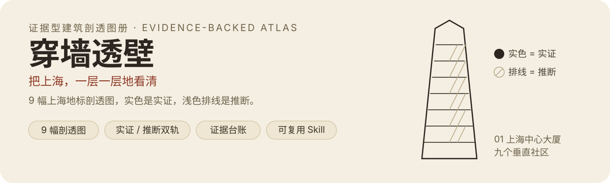
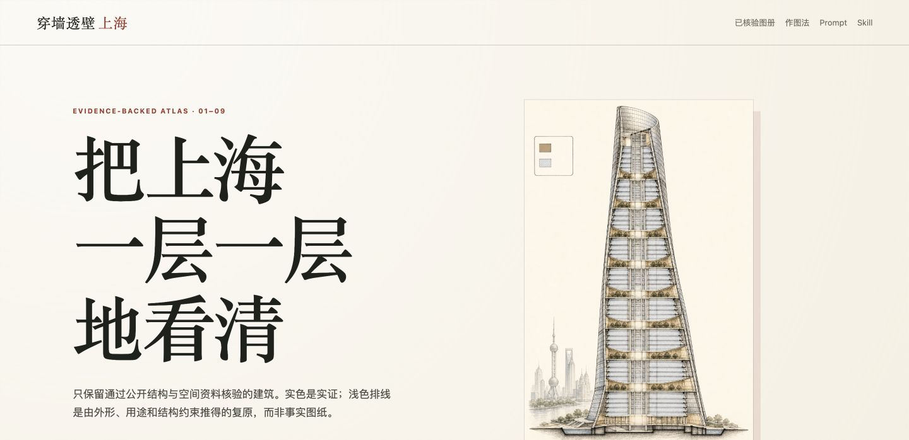

<p align="right"><a href="README.md">中文</a></p>

<p align="center">
  
</p>

<p align="center">
  <a href="https://shanghai-through-walls.xiaosang.cc/">▶ View the Atlas</a>
  ·
  <a href="https://holynova.github.io/shanghai-through-walls/">Mirror on GitHub Pages</a>
  ·
  <a href="https://github.com/holynova/shanghai-through-walls">GitHub Repository</a>
</p>

Shanghai Through Walls is an evidence-backed atlas of architectural cutaways of Shanghai landmarks: precise axonometric plates slice through façades to reveal stair wells, structural frames, and interior space. Every plate draws a hard line — dark ink for verified structure, pale hatching for constrained inferred reconstruction. Inference never poses as fact.

## Screenshots

<p align="center">
  
</p>

## The 9 Plates

| No. | Building | Type | Verified highlights |
|------|------|------|----------|
| 01 | 上海中心大厦 (Shanghai Tower) | Supertall | Nine vertical communities, double-skin façade atria, sky gardens |
| 02 | 东方明珠 (Oriental Pearl Tower) | Observation tower | Spheres, observation decks, revolving restaurant, double-deck elevators |
| 03 | 中华艺术宫 (China Art Museum) | Art museum | Program levels at 0m / 33m / 41m / 49m / 60m, cantilevered mega-columns |
| 04 | 徐家汇圣依纳爵主教座堂 (Cathedral of St. Ignatius, Xujiahui) | Gothic Revival | Latin-cross plan, three aisles, pointed-arch clustered columns, choir loft |
| 05 | 摩西会堂 (Ohel Moishe Synagogue) | Jewish heritage | Three-story outer gallery, red-brick pitched roof, mosaic floor, Holy Ark |
| 06 | 上海音乐厅 (Shanghai Concert Hall) | Shanghai classical | Proscenium stage, dome, the story of its whole-building relocation |
| 07 | 上海交响乐团音乐厅 (Shanghai Symphony Hall) | Acoustic engineering | Large and small halls, vibration isolators, a 「房中房」 ("room within a room") acoustic shell |
| 08 | 龙美术馆西岸馆 (Long Museum West Bund) | Industrial heritage | Coal hoppers of the Beipiao Wharf, fair-faced concrete 「伞拱」 ("umbrella vaults") |
| 09 | 上海油罐艺术中心 (Tank Shanghai) | Industrial conversion | Aviation fuel tanks, circular domes, full-height galleries, three-story tank volumes |

Every plate carries two public source links (official sites, government, archives, academic institutions). Buildings with insufficient evidence are not drawn: 静安寺 (Jing'an Temple), 海关大楼 (Customs House), 和平饭店北楼 (Peace Hotel North Building), 武康大楼 (Wukang Building), 上海展览中心 (Shanghai Exhibition Centre), 上海博物馆 (Shanghai Museum), and 金茂大厦 (Jin Mao Tower) were reviewed and left out — see `research/evidence-ledger.md`.

## Method

- **Two-track drawing, verified vs inferred**: solid color only for source-supported features; areas without direct documentation are drawn only as constrained reconstructions from verified geometry, levels, program, and structural type — always in pale hatching, never with room names or precise floor plans.
- **Evidence ledger**: `research/evidence-ledger.md` records, feature by feature for every plate, whether it is verified or inferred, on what basis, and how it may be drawn.
- **Reusable skill**: `skill/` packages the full workflow (research process + prompt template) — feed in "building name + city name", get a research pack first, then the plate; the same standard applies to any city.

## Features

- **Atlas browsing**: the 9 plates displayed vertically, each with its type, commentary, and source links.
- **Zoomed reading**: click a plate to open a lightbox and inspect steel joints, brick-and-concrete junctions, and skyline silhouettes up close.
- **One-click prompt copy**: the site includes the full generation prompt, ready to copy and reuse for similar cutaways.

## Run Locally

```bash
npm install
npm run dev       # dev server
npm run build     # production build
```

## Tech

- Pure JavaScript + Vite, zero runtime dependencies; content data in `src/main.js` (building list and prompts), styles in `src/style.css`.
- The 9 cutaway plates live in `public/images/` (portrait 3:4, pen-and-ink with light watercolor wash on warm paper).

```
index.html                  Entry (atlas / method / prompt / skill, four sections)
src/main.js                 Building data, atlas rendering, lightbox, prompt copy
src/style.css               Warm-paper editorial style
public/images/              9 cutaway plates
research/evidence-ledger.md Evidence ledger (9 plates + 7 buildings not included)
skill/                      Reusable drawing skill (research process + prompt template)
```
