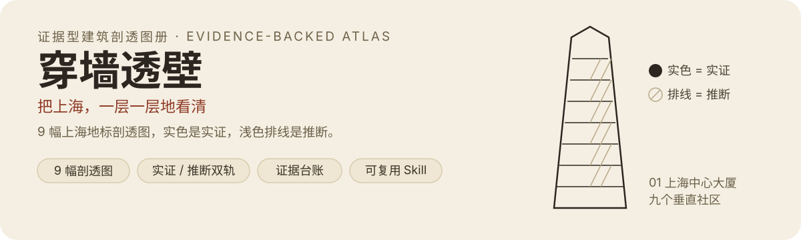
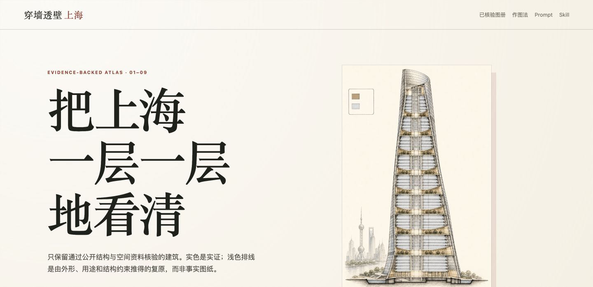

<p align="center">
  
</p>

<p align="center">
  <a href="https://shanghai-through-walls.xiaosang.cc/">▶ 在线看图 Live Demo</a>
  ·
  <a href="https://holynova.github.io/shanghai-through-walls/">备选镜像 GitHub Pages</a>
  ·
  <a href="https://github.com/holynova/shanghai-through-walls">GitHub 仓库</a>
</p>

穿墙透壁是一本以上海地标为对象的证据型建筑剖透图册：用严谨的工程轴测图切开外立面，展现楼梯井、钢混骨架与室内空间。画面严格区分两类内容——深色墨线是可核实的实证结构，浅色排线是受约束的推断复原，推断永远不冒充事实。

Shanghai Through Walls is an evidence-backed atlas of architectural cutaways of Shanghai landmarks: precise axonometric plates slice through façades to reveal stair wells, structural frames, and interior space. Every plate draws a hard line — dark ink for verified structure, pale hatching for constrained inferred reconstruction. Inference never poses as fact.

## 截图 / Screenshots

<p align="center">
  
</p>

## 收录的 9 幅图 / The 9 Plates

| 编号 | 建筑 | 类型 | 实证要点 |
|------|------|------|----------|
| 01 | 上海中心大厦 | 超高层 | 九个垂直社区、双层幕墙公共区、空中花园 |
| 02 | 东方明珠 | 观光塔 | 球体、观光层、旋转餐厅、双轿厢电梯 |
| 03 | 中华艺术宫 | 美术馆 | 0m / 33m / 41m / 49m / 60m 功能层级、巨柱悬挑 |
| 04 | 徐家汇圣依纳爵主教座堂 | 哥特复兴 | 拉丁十字平面、三通廊、尖拱束柱、唱诗楼 |
| 05 | 摩西会堂 | 犹太遗产 | 三层外廊、红砖斜顶、马赛克地坪、约柜 |
| 06 | 上海音乐厅 | 海派古典 | 镜框式舞台、穹顶、整体平移的空间故事 |
| 07 | 上海交响乐团音乐厅 | 声学工程 | 大小音乐厅、隔振器、「房中房」声学外壳 |
| 08 | 龙美术馆西岸馆 | 工业遗产 | 北票码头煤漏斗、清水混凝土「伞拱」 |
| 09 | 上海油罐艺术中心 | 工业改造 | 航油罐、圆形穹顶、通高展厅、三层罐体 |

每幅图都附两条公开来源链接（官网、政府、档案馆、学术机构）。证据不足的建筑不画：静安寺、海关大楼、和平饭店北楼、武康大楼、上海展览中心、上海博物馆、金茂大厦经评审后未收录，见 `research/evidence-ledger.md`。

## 画法规则 / Method

- **实证 vs 推断双轨制图**：实色只画来源可核的特征；无直接文献的区域，只按已核实的外形、层数、用途、结构类型做受约束复原，一律用浅色排线，不标房间名、不画精确平面。
- **证据台账**：`research/evidence-ledger.md` 逐条记录每幅图的每个特征是实证还是推断、依据是什么、允许怎么画。
- **可复用的 Skill**：`skill/` 是一套完整工作流（研究流程 + Prompt 模板），输入「建筑名 + 城市名」，先做研究包、再出图，同一套标准可以复用到其他城市。

## 功能 / Features

- **图册浏览**：9 幅图纵向陈列，每幅附类型、解说与来源链接。
- **放大微阅**：点图打开灯箱，细看钢梁节点、砖混交接与天际线轮廓。
- **一键复制 Prompt**：站内附完整作图 Prompt，可直接复制去生成同类剖透图。

## 本地运行 / Run Locally

```bash
npm install
npm run dev       # 开发服务器
npm run build     # 生产构建
```

## 技术 / Tech

- 纯 JS + Vite，零运行时依赖；内容数据在 `src/main.js`（建筑列表与 Prompt），样式在 `src/style.css`。
- 9 幅剖透图在 `public/images/`（竖版 3:4，暖纸底钢笔线 + 淡彩）。

```
index.html                  入口（图册 / 作图法 / Prompt / Skill 四节）
src/main.js                 建筑数据、图册渲染、灯箱、Prompt 复制
src/style.css               暖纸底编辑风
public/images/              9 幅剖透图
research/evidence-ledger.md 证据台账（9 幅图 + 7 座未收录）
skill/                      可复用的作图 Skill（研究流程 + Prompt 模板）
```

## English

**Shanghai Through Walls** is an evidence-backed atlas of architectural cutaways of Shanghai landmarks — 9 plates in precise pen-and-ink with restrained watercolor wash on warm ivory paper.

- **Verified vs inferred, drawn differently**: dark solid line and wash only for source-supported claims; pale wash and fine hatching for constrained reconstructions derived from verified geometry, levels, program, and structural type — never labelled as fact.
- **The 9 plates**: Shanghai Tower, Oriental Pearl Tower, China Art Museum, Cathedral of St. Ignatius (Xujiahui), Ohel Moishe Synagogue, Shanghai Concert Hall, Shanghai Symphony Hall, Long Museum West Bund, Tank Shanghai. Each carries two public source links.
- **What didn't make it**: 7 buildings (Jing'an Temple, Customs House, Peace Hotel North, Wukang Building, Shanghai Exhibition Centre, Shanghai Museum, Jin Mao Tower) were reviewed and skipped for lack of corroborated public interior evidence — documented in `research/evidence-ledger.md`.
- **Reusable skill**: `skill/` packages the full workflow (research process + prompt template) so the same standard applies to any building in any city.
- **Run it**: `npm install && npm run dev`. Pure JavaScript + Vite, zero runtime dependencies.
