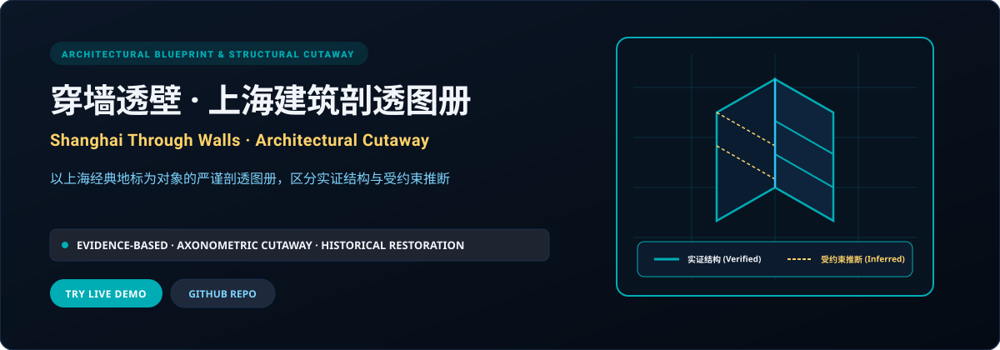
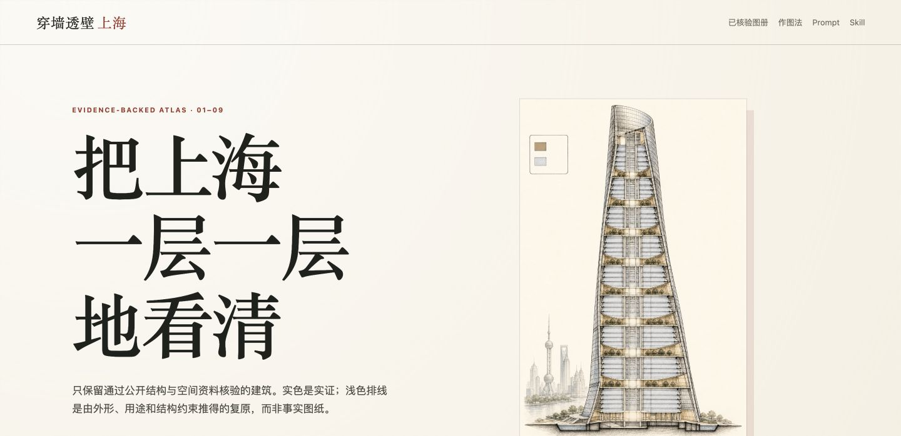

<p align="right">
  <strong>简体中文</strong> · <a href="./README.en.md">English</a>
</p>

<p align="center">
  
</p>

<p align="center">
  <a href="https://shanghai-through-walls.xiaosang.cc/"><strong>🌐 在线体验 (Live Demo)</strong></a> · 
  <a href="https://holynova.github.io/shanghai-through-walls/"><strong>🚀 备选镜像 (GitHub Pages)</strong></a> · 
  <a href="https://github.com/holynova/shanghai-through-walls"><strong>📦 GitHub 源码</strong></a> · 
  <a href="https://xiaosang.cc/"><strong>✨ 更多作品集</strong></a>
</p>

---

## 真实预览 (Proof of Work)

<p align="center">
  
</p>

---

## 项目简介 (What It Is)

以上海历史与现代地标为对象的建筑剖透图册，将公开资料与推断复原放在一起阅读。配套研究资料位于 [research/](research/)，阅读图像时请对照来源及推断边界。

---

## 核心机制与特色 (Why It Matters)

- **实证 vs 推断双轨制图**：用深浅墨线区分资料依据与推断复原；具体结构以对应研究记录为准。
- **等轴测三维空间透视**：突破二维立面局限，层层切开外立面，展现楼梯井、钢混骨架与室内空间流线。
- **地标档案文献交叉印证**：附带详细的文献出处与测绘考据，让历史保护建筑的内部构造清晰可循。
- **互动式图纸放大微阅**：支持深度平移缩放阅读，微观展现钢梁节点、砖混交接与天际线轮廓。

---

## 收录清单与规格 (Inventory & Scope)

武康大楼、国际饭店、上海大厦（百老汇大厦）、徐家汇天主教堂、摩西会堂、上海交响乐团音乐厅、上海中心大厦等代表性建筑剖透图。

---

## 快速开始 (Quick Start)

### 1. 在线体验
无需安装任何环境，直接在浏览器中打开：
- 🌐 **主站演示 (Primary)**：[https://shanghai-through-walls.xiaosang.cc/](https://shanghai-through-walls.xiaosang.cc/)
- 🚀 **备选镜像 (GitHub Pages)**：[https://holynova.github.io/shanghai-through-walls/](https://holynova.github.io/shanghai-through-walls/)

### 2. 本地运行与调试
克隆仓库后执行以下命令：

```bash
git clone https://github.com/holynova/shanghai-through-walls.git
cd shanghai-through-walls
pnpm install --frozen-lockfile
pnpm dev
```

---

## 开源协议与作者 (License & Author)

- **作者**：[holynova (小桑)](https://xiaosang.cc/)
- **授权说明**：仓库当前未附独立 LICENSE 文件；复用代码或素材前请确认相应授权。
- **合辑收录**：本仓库作为精选项目收录于 [Where Craft Lives (xiaosang.cc)](https://xiaosang.cc/)。
